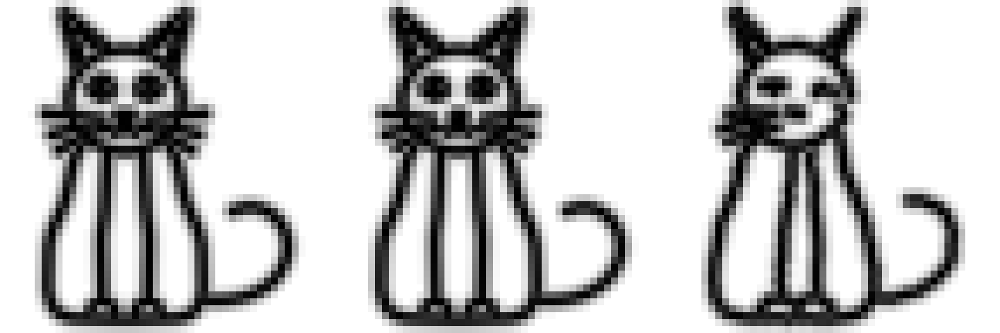
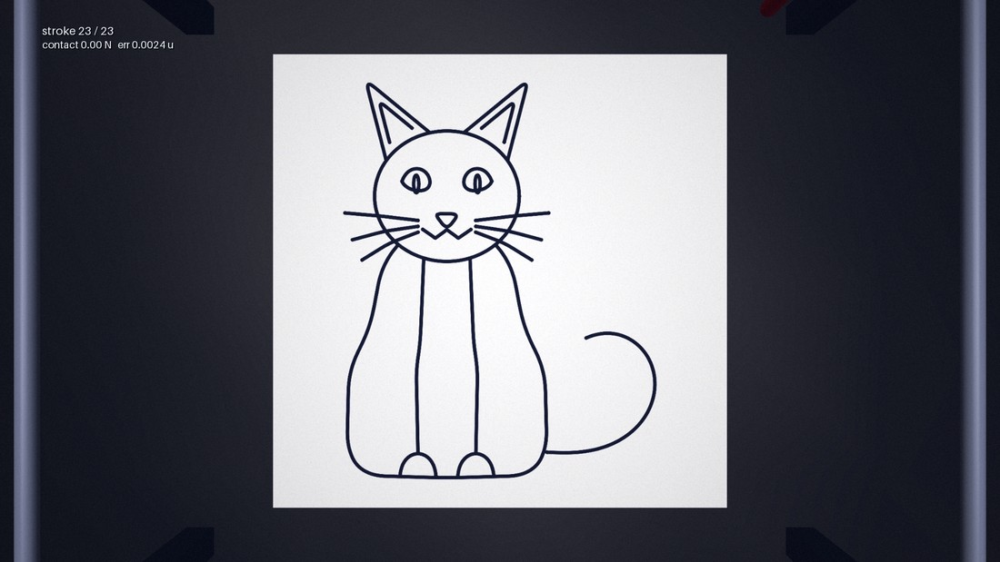
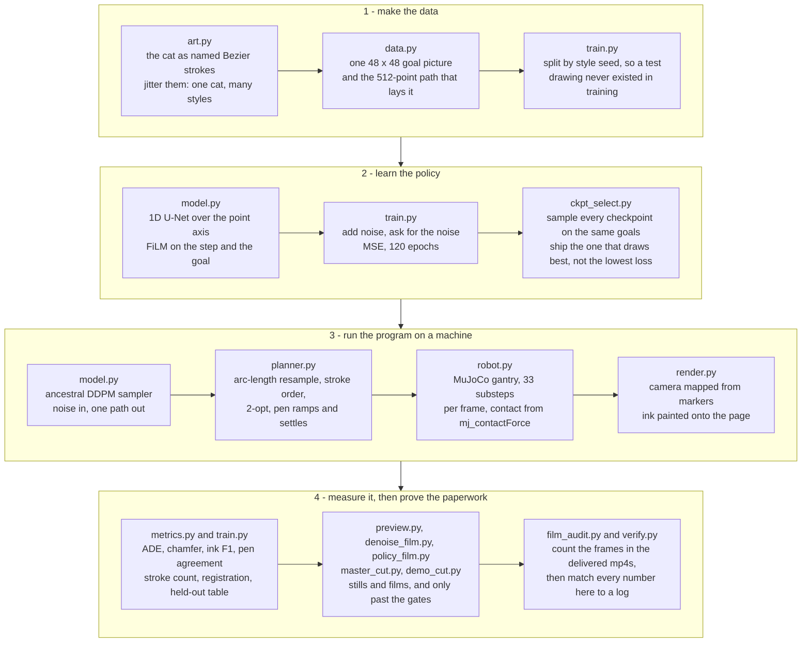
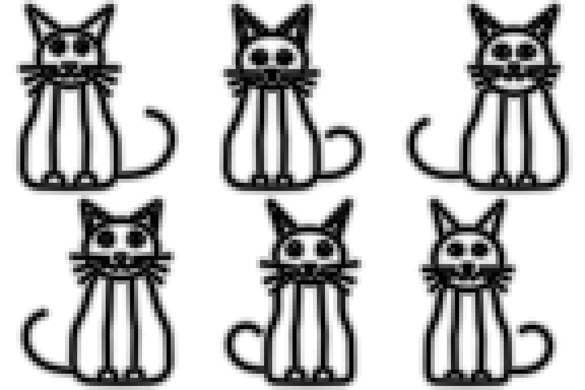
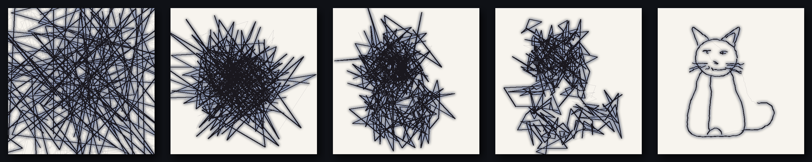
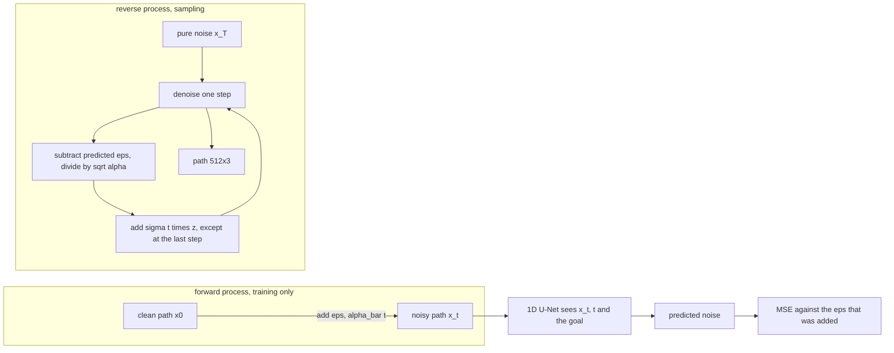
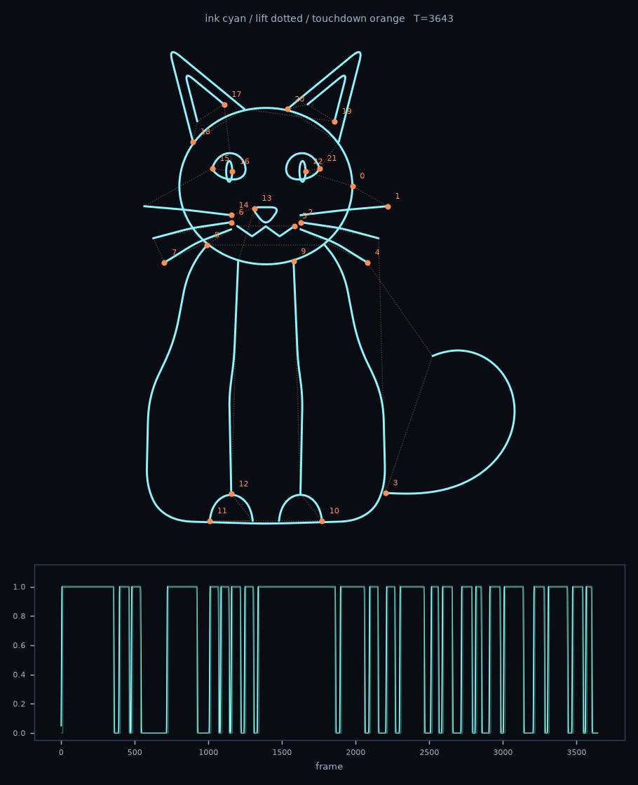
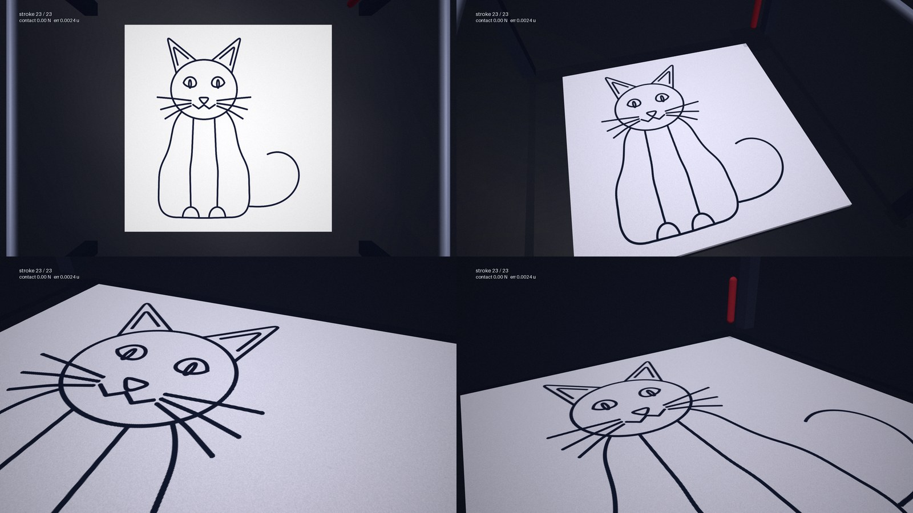

# CatMotion

**Goal-Conditioned Diffusion Policy for Robotic Drawing**

A neural network is shown a small picture of a cat and outputs the pen program that draws
it. A simulated pen plotter then runs that program, and a calibrated camera measures where
the ink actually landed.



Left is the `48 x 48` picture the network was given. Middle is the ink of the reference program
and right is the ink of the network's own program, both paths run through the same rasteriser
that made the goal, so the three panels are picture against picture. It is not a perfect cat:
`19` of the `23` reference strokes come back and this one drawing scores ink F1 `0.729` against
its goal. That number is the point of the project rather than a caveat under it.

If you have two minutes rather than an afternoon, the cut to watch is listed first in
[The films](#the-films).

This is a personal engineering project. I taught myself diffusion policy and robot learning,
and I built this to find out whether I could take one all the way through: model, planner,
simulated machine, camera, metrics, films. It is not a research paper and it does not claim a
novel method.

The part that matters to me is that it does not stop at the trajectory. Most "diffusion policy"
demos end when the network outputs one. Everything interesting happens after that: the pen that
lifts one frame too late, ink that lands two millimetres from where the path said it would, and
the checkpoint with the best loss that draws the worst cat. This project keeps going until the
ink is on the page, and then measures it.

## Contents

- [What the system does](#what-the-system-does)
- [Problem formulation](#problem-formulation)
- [Results](#results)
- [The films](#the-films)
- [Architecture](#architecture)
- [The drawing and the dataset](#the-drawing-and-the-dataset)
- [The policy](#the-policy)
- [The machine](#the-machine)
- [The camera and the gates](#the-camera-and-the-gates)
- [The checkpoint finding](#the-checkpoint-finding)
- [Install and run](#install-and-run)
- [Where everything ran](#where-everything-ran)
- [Project layout](#project-layout)
- [The verification harness](#the-verification-harness)
- [Limitations](#limitations)
- [What I would do next](#what-i-would-do-next)
- [Tech](#tech)

## What the system does

Input: a `48 x 48` picture of a cat. Output: `512` points of `(x, y, pen)`, in the order the
pen should visit them. That program is resampled, ordered and timed by a motion planner,
executed by a MuJoCo model of a two-axis gantry with a spring-loaded pen, and rendered by a
camera whose mapping from canvas to pixels was solved from markers and then checked against
held-out markers.



The policy is a conditional DDPM: a 1D U-Net over the point axis, FiLM-conditioned on the
diffusion step and on the goal picture, trained to predict noise.

## Problem formulation

Let `g` be a `48 x 48` goal raster and `tau` be a path of `512` points in `[-1, 1]^2` with a pen
channel in `{-1, +1}`. Learn `p(tau | g)`.

Two properties make this a generative problem rather than a regression problem.

One picture admits many correct answers. The strokes can be drawn in different orders, a stroke
can be traversed in either direction, and the points can be spaced differently along the same
ink. A discriminative head trained on that data converges toward the mean of the answers, and
the mean of many valid drawings is a path whose pen barely lifts. The `mean-path` baseline in the
table below is exactly that object, and it scores `0.192`.

The output is a program, not a trajectory to plot. A wrong pen state is a blot or a missing line,
and a lagging servo is a crooked stroke, so the loss on the noise is not the thing I care about.
What I care about is whether the machine can execute it and whether the ink lands where the
picture says. That is why the evaluation is done through the robot and the camera, and why
checkpoint selection is done on sampled drawings instead of on validation loss.

## Results

Held-out test set: `32` goal pictures the model never saw, sampled once with a fixed seed at
`50` diffusion steps, on the shipped checkpoint (epoch `120`).

| metric | policy | mean-path baseline | static-path baseline |
| --- | --- | --- | --- |
| ink F1 against the goal | `0.722` | `0.192` | `0.536` |
| ink precision / recall | `0.766` / `0.684` | - | - |
| ADE, canvas units | `0.6905` | `0.5165` | `0.7125` |
| chamfer distance | `0.034` | - | - |
| strokes found (reference `22.0`) | `20.6` | - | - |
| off-target ink distance | `0.023` | - | - |
| stray fraction | `0.096` | - | - |
| pen down/up agreement | `0.675` | - | - |
| path stays on the sheet (max abs xy) | `0.945` | - | - |

Two notes on how that table was made. Every figure is the mean column: `metrics.report` returns
`(mean, worst)` for each metric, and the worst-of-32 values are in the log too. And this is the
seed `999` run only. The checkpoint-selection stage samples the same weights at seed `1234`,
which gives slightly different numbers for the same epoch, so a row from one and a row from the
other should never sit in the same table.

Read the two rows that disagree with each other. The policy wins on ink F1 by a wide margin and
loses on ADE to the mean path. That is what a multimodal target does when you score it
point-by-point in path order. The average of all training paths sits close to every reference
and draws nothing recognisable, which is exactly what the `0.192` row is. The policy commits to
one valid ordering and draws a cat.

The weakest real number here is pen agreement at `0.675`. About a third of sample positions
disagree with the reference about whether the pen is down, and they cluster at the lift
transitions. The stroke count it produces, `20.6` against `22`, is the visible consequence. I
report it rather than drop it.

## The films

Four cameras, one machine, one network. All `1080p` at `30 fps`.

| file | frames | seconds | size | what it shows |
| --- | --- | --- | --- | --- |
| `design_out/cat_demo_delivery.mp4` | `4823` | `160.77` | `135.8` MB | the two-minute-forty cut for a first-time viewer - this is the one to watch |
| `design_out/cat_demo.mp4` | `4823` | `160.77` | `1431.8` MB | the same cut at the encoder's top quality |
| `design_out/cat_master_delivery.mp4` | `3158` | `105.27` | `134.9` MB | the archival cut, re-encoded from the same decoded frames, small enough to send |
| `design_out/cat_master.mp4` | `3158` | `105.27` | `1430.2` MB | the whole argument in build order: the model, then the machine, then the network's own path on that machine |
| `design_out/cat_denoise.mp4` | `293` | `9.77` | `14.9` MB | one reverse process, noise condensing into a cat |
| `design_out/cat_film.mp4` | `1454` | `48.47` | `764.3` MB | the reference artwork drawn by the gantry |
| `design_out/policy_film_hero.mp4` | `1276` | `42.53` | `668.8` MB | the network's program, drawn by that same machine |
| `design_out/cat_denoise_gt.mp4` | `444` | `14.8` | `40.1` MB | the forward process on a reference path, needs no trained network |

The demo cut re-edits footage that already exists. Nothing in it is re-rendered: the moving
frames come from the three films above, the stills are files the pipeline already wrote, and every
figure on a card is read out of `out/` when the file is built. A card whose evidence file is
missing is skipped rather than shown, so the cut cannot present a number nobody measured.

The order it tells the story in, with the timestamps `src/demo_cut.py` wrote to
`out/demo_cut.json` after it had counted the frames it actually encoded:

| beat | on screen |
| --- | --- |
| `0:00` to `0:03` | title |
| `0:03` to `0:11` | the finished page |
| `0:11` to `0:19` | the goal picture, the only input the network gets |
| `0:19` to `0:33.8` | one reverse process: noise condensing into a path |
| `0:33.8` to `0:41.8` | the network's own path, scored against its goal |
| `0:41.8` to `1:33.2` | the reference drawing running on the gantry |
| `1:33.2` to `2:20.8` | the network's program running on that same machine |
| `2:20.8` to `2:30.8` | the held-out test, and the checkpoint that was not chosen |
| `2:30.8` to `2:35.8` | what this is not |
| `2:35.8` to `2:40.8` | where every number on the film lives |

The films are not in git. GitHub rejects files over `100` MB and the smallest sendable cut here is
`134.9` MB, so the repository carries the stills and the frame counts, and the videos stay on the
machine that rendered them. `src/film_audit.py` measures the delivered containers and writes
`out/films.json`, so every frame count above is a property of a file rather than something the
encoder remembered. Each delivery copy audits at the same frame count as its archival parent,
which is the check that the smaller file is not a shorter one.

## Architecture

The whole project in one picture. Every box is a file in `src/`, and the four bands are the
four things I had to get right, in the order I built them.



One thing this diagram leaves out on purpose. There is no feedback arrow from the camera back to
the policy. The sampler runs once, the whole program is handed to the machine, and the machine
executes it open loop. See [Limitations](#limitations).

## The drawing and the dataset



The cat is not a photograph and not a hand-drawn scan. It is a named list of Bezier strokes:
head, two ears, two ear inners, two eyes, two pupils, nose, mouth, four whisker pairs, body,
leg, paw, tail. `art.py` jitters the control points inside bounded regions, so the family looks
like one artist drawing the same cat many times. That is what makes the ground truth exact and
the round trip testable.

`data.py` turns each style into one pair: the goal raster, and the `512`-point path that lays
it, sampled evenly in arc length. Even arc-length sampling matters because the policy is scored
at exactly `512` points, so the target cannot depend on how many waypoints the artwork happened
to use.

The pen channel is stored at `+/-1`, not `0/1`. All three channels then share one scale, which
is what lets one noise schedule serve the geometry and the switch at the same effective rate.
Store the pen in `[0, 1]` next to positions in `[-1, 1]` and the diffusion process adds and
removes noise from the switch at a different rate from the coordinates.

The self-test proves the representation can carry the artwork instead of assuming it. Rasterising
the `512`-point path back to a picture matches its own goal at F1 `0.989`, worst family member
`0.982`. The path step is `0.0361` units and every stroke in `12` sampled styles is longer than
three steps, because a stroke shorter than the sampling interval could never survive it and
would put targets in the dataset that no policy could be credited for drawing.

## The policy



The model is a `1D` U-Net over the point axis with three resolutions at `96`, `128` and `192`
channels, and `3.69 M` parameters. Each residual block is conditioned through FiLM on
`concat(time_embedding, goal_embedding)`. Each level has one attention window over the whole
path, because a stroke's first point has to know its last point and a three-tap kernel cannot
say that at any depth without `512` points of receptive field growth. Without it a predicted
whisker comes out as two disconnected halves.

Forward and reverse:

```
x_t     = sqrt(alpha_bar_t) * x_0 + sqrt(1 - alpha_bar_t) * eps
loss    = MSE(net(x_t, t, goal), eps)
mean    = (x_t - sqrt(1 - alpha_bar_t) * eps) / sqrt(alpha_t)
x_{t-1} = mean + sigma_t * z,   sigma_t = sqrt((1 - alpha_bar_{t-1}) / (1 - alpha_bar_t) * beta_t)
```

Training draws `t` uniformly and predicts noise, not the sample. Sampling is ancestral DDPM:
noise is added at every step except the last, where the posterior variance is zero by
definition. The schedule is cosine alpha-bar, clipped at both ends, so `alpha_bar` reaches
`0.0000` at the noisy end and the sampler starts from a distribution the network was actually
trained on. `alpha` is clamped at `1e-3`, because the last step of a cosine schedule otherwise
turns `1/sqrt(alpha)` into a six-times amplifier on whatever the network has not learned.



The two halves share one network. Training never sees a sampled path and sampling never computes
a loss.

Goal conditioning is measured, not assumed. On untrained weights, the same seed with a real goal
and with a blank goal moves the path by `30.85` mean absolute units. On the shipped weights the
same test across the schedule gives `0.462`. Without that check you cannot tell a
goal-conditioned policy apart from an unconditional prior that happens to draw a nice cat.

The reverse process, frame by frame, from the shipped checkpoint:

| | first state (pure noise) | last state (sample) |
| --- | --- | --- |
| ink F1 against the goal | `0.395` | `0.794` |
| ink on the page | `268.2` units | `15.25` units |
| pen down | `55` percent | `79` percent |
| alpha-bar | `0.0000` | `0.9972` |

That final path scores ADE `0.8448`, ink F1 `0.794`, chamfer `0.0328`, and finds all `23`
strokes of the hero drawing.

## The machine



A flatbed gantry in MuJoCo `3.17`. Two prismatic axes with a carriage and a head, a pen body
that slides in `z` against a spring, and a `0.800 mm` radius ball tip over a `20 cm` square
sheet. The physics timestep is `0.0005 s`, which at the `60 Hz` control rate is `33` substeps
per commanded frame.

The controller is worth stating precisely, because it is where a naive version visibly fails:

```
f = kp * (x_ref - x) + kv * (v_ref - v)
```

Proportional on position error, with the reference velocity fed straight into the derivative
term. There is no inertia term. A `<position>` actuator chasing a target leaves a steady-state
lag of `kv*v/kp`, which on this machine is a visible offset that bends at every direction
change. Feeding velocity forward removes it. The setpoint is also swept across the frame rather
than held at the frame's start, because holding it while feeding forward its velocity biases the
pen backwards by about `0.2 mm`, which you can see at `1080p`.

The pen is not a kinematic constraint. Its target is biased up by exactly the gravity droop,
`m*g/kp`, so the commanded height is the achieved height. Contact is read from
`mj_contactForce`, normal component only, because tangential friction is not the pen writing. A
frame counts as laying ink if the ball touched the paper at any instant inside it. Sampling only
the last instant catches the pen mid-oscillation and reports a gap that is not on the page.

Measured on the hero program:

| | |
| --- | --- |
| program | `3643` frames, `23` strokes, `14.57` units of ink, `4.52` units of lift travel |
| tracking error while drawing | rms `0.00023`, max `0.00141` canvas units |
| tracking error while airborne | max `0.00242` |
| mean normal force while drawing | `0.575 N` |
| pen travel | lift `6.00 mm`, press `6.40 mm` |
| commanded spacing | `0.0060` units, achieved mean `0.0061`, std `0.0001`, max `0.0063` |

The planner fixes three defects that make a naive pen video read as noise. Strokes are
resampled by arc length so constant-speed playback lays even ink; resampling by point count
instead gives facets on long curves and blotches on short ones, because point density then
follows how the artist happened to sample the Bezier. Stroke order is greedy nearest neighbour
with free direction reversal, then 2-opt that reverses whole slices and flips every stroke
inside them, which is the only way a reversal stays legal; that ordering costs `4.522381` units
of lift travel against `4.7725` for plain greedy. And every stroke is ramp, settle, draw, ramp,
so the pen is already at rest on the paper before ink flows and fully lifted before the carriage
moves.

## The camera and the gates



The renderer's claim is not "I drew ink where I wanted". It is "the ink in this image is where
the simulated pen put it, and here is the error". Ink is a texture painted onto the page
geometry through an affine map solved from marker positions, not a screen-space overlay. That is
what makes registration measurable rather than assumed. With an overlay you cannot even ask the
question.

One marker proves the map at one point, so `stroke_registration` paints each stroke separately
and finds it in the image, stroke by stroke, using the pen's achieved positions. That catches an
error that happens to cancel in the aggregate.

| check | gate | measured |
| --- | --- | --- |
| held-out marker registration | `6.0 px` | `0.04 px` worst of `5` |
| per-stroke registration, worst stroke | `6.0 px` | `1.22 px` |
| per-stroke registration, median | - | `0.54 px` |
| finished-page ink centroid | `12.0 px` | `0.5 px` over `41193` ink px |
| ink area against program ink | `0.55x` to `1.9x` | `0.2444` against `0.2331` square units |
| gantry shadow on the worst-lit `5` percent of the sheet | `< 0.30` | `0.148` |
| texels per canvas unit | `0.8` to `1.25` of expectation | `472` |

The policy film passes the same gates on the network's own drawing. Its numbers are worse, and
the reason is in the path: worst stroke registration `4.38` px against the reference program's
`1.22` px, centroid `6.3` px. The network's shortest stroke is shorter and its lifts land
between the reference dots, so the least-squares fit has fewer pixels to work with. It is inside
the gate the film refuses to render without, and it is printed on the film's own end card.

## The checkpoint finding

This is the result I would put on a whiteboard.

| weights | epoch | val eps-MSE | val ADE | val ink F1 | val strokes |
| --- | --- | --- | --- | --- | --- |
| `policy_best.pt` | `10` | `0.0909` | `0.8344` | `0.3097` | `4.9` |
| `policy_last.pt` | `120` | `0.2289` | `0.6100` | `0.7319` | `20.2` |

The lowest validation loss and the best drawing are different epochs, by a wide margin. eps-MSE
is a pointwise regression loss on the noise. A network that predicts a smooth, plausible,
low-amplitude noise field scores well on it while producing a path whose pen barely lifts. That
is what epoch `10` does: `4.9` strokes where the reference has `21.8`, and two thirds of its
pen-down samples sitting more than `0.05` units from the reference ink. The epoch `120` weights
have a worse noise loss because they commit to sharper structure, and they draw a cat.

So the project does not select by loss. `src/ckpt_select.py` samples every candidate over the
same validation goals with one shared seed, ranks by sampled ADE, writes `ckpt/policy_ship.pt`,
records the full ranking in `out/checkpoint_select.json`, and then proves the shipped file
reproduces the chosen sample exactly. One loader, `model.load_policy`, is used by the
measurement, the films and the shipped artifact, so the checkpoint being graded, being filmed and
being shipped cannot quietly be three different sets of weights.

## Install and run

```
pip install -r requirements.txt
python src/verify.py --selftest
python src/train.py --samples 1600 --epochs 120
python src/denoise_film.py --film
python src/render.py --film
python src/policy_film.py --goal hero --film
python src/master_cut.py
python src/demo_cut.py
python src/film_audit.py
python src/verify.py
```

`train.py` runs the selection stage itself: it trains, asks `ckpt_select.py` which set of weights
actually draws, writes `ckpt/policy_ship.pt`, and reports test numbers on that file rather than
on whichever epoch happened to land last.

Training config, from `out/train_log.json` and `out/train_run_log.txt`:

| | |
| --- | --- |
| styles | `1600` train, plus held-out validation and test sets |
| split | by style seed, from three disjoint ranges (`VAL_SEED0` and `TEST_SEED0` in `src/train.py`), so a test cat is a drawing that never existed in the training set in any form |
| optimiser | `AdamW`, weight decay `1e-4`, learning rate `0.0003` |
| schedule | `OneCycleLR` with `pct_start=0.1`, gradient norm clipped at `1.0` |
| batch / epochs | `64` / `120` |
| diffusion | `50` steps, eps-prediction |
| seed | `7` |
| wall clock | `5956 s` on CPU |

The seed ranges are named constants in the code and the next training run writes them into
`train_log.json`; the log shipped here predates that line, so they are quoted as code rather
than as a measurement.

On a machine without a GPU, `--smoke` proves the plumbing in about a minute and writes nothing
that looks like a result.

Environment everything above was produced on, measured by `verify.py` into `out/env.json`:
`python 3.15`, `torch 2.15.0+cpu`, `mujoco 3.17`, `numpy 2.5.4`, `pillow 13.0`, `imageio 2.38.1`,
`imageio-ffmpeg 0.7.0` with `ffmpeg 7.1`, `16` cores, Windows.

## Where everything ran

Every number in this README came off one machine: a `16`-core Windows box with no CUDA device in
it. `out/train_log.json` records `"device": "cpu"` and the CPU build of torch, and `out/env.json`
records the rest of the environment. There are no GPU results in this repository, so none of the
tables above depend on hardware you do not have, and none of them depend on a service you have to
sign up for. The dataset is generated by `art.py` on your machine, the weights are trained by
`train.py` on your machine, and the films are rendered and encoded on your machine.

## Project layout

```
src/geometry.py      arc-length resampling, polyline length, spline evaluation
src/art.py           the cat as parametric strokes, and the style family
src/planner.py       strokes -> ordered, direction-decided, timed pen program
src/data.py          one (goal raster, pen path) pair per style, and the round trip
src/model.py         the 1D U-Net, the cosine schedule, the ancestral sampler
src/metrics.py       four independent ways to score a path, plus two baselines
src/train.py         the training loop, the held-out report, the checkpoint question
src/ckpt_select.py   which checkpoint ships, decided on sampled drawings
src/robot.py         the gantry: MuJoCo model, controller, contact measurement
src/render.py        camera calibration, ink as a texture, grading, the film
src/denoise_film.py  the sampler as film, with gates that refuse a broken model
src/policy_film.py   the network's path through the machine, end to end
src/master_cut.py    the three films as one continuous cut
src/demo_cut.py      the same footage recut for a first-time viewer
src/film_audit.py    measure the delivered mp4s instead of trusting their builders
src/preview.py       the stills
src/verify.py        re-run every claim, then refuse to let the prose outrun the logs

out/                 machine-written JSON and logs, the only source of every number
media/               web-sized stills used by this README

not in git, produced locally by the commands above:
data/                the generated (goal, path) pairs
ckpt/                the weights, about 45 MB
design_out/          the films and the full-size stills
```

## The verification harness

`python src/verify.py` does two jobs. It runs each module's own self-test, and it reads every
numeric literal in every `.md` file in this folder and demands that the same number appear in a
log that a machine wrote. A figure that is not in a log is a figure nobody measured, and the run
exits non-zero over it. Table rows, code blocks and file names are exempt, because a table quotes
another document and a code block is a command.

The last full run, copied out of the harness's own output:

```
LOGS    1775 numbers from checkpoint_select.json, demo_cut.json, denoise_trace.json, denoise_trace_gt.json, env.json, films.json, master_cut.json, policy_draw.json, policy_eval.json, train_log.json
PROSE   235 numbers match a log, 0 do not
VERIFY PASS  8 self-tests, 1775 logged numbers, 3 docs audited
```

`LOGS` is how many numbers the machine wrote down. `PROSE` is how many numbers the documents
claim, and how many of them no log supports. A non-zero count there exits the run `1`, which is
the whole point: the prose cannot outrun the evidence.

Two things it does not catch, and I found both by reading rather than by running it. It checks
that a number exists in *some* log, not that it came from the same run as the sentence around it,
and it skips table rows - which is exactly where that mistake was hiding, in a row that quoted one
sampling seed next to a figure from another. The fix was to name the run in the prose, not to
loosen the harness.

That rule is also why the films are audited separately. `film_audit.py` decodes each delivered
file and reports its own frame count, resolution, rate, size and digest, so "the film is `293`
frames" is a property of the file rather than a hope the encoder remembered. The renderers write
under a `.part.mp4` name and move it into place only after the encoder closed, so a half film on
disk means a run died, and `film_audit.py` refuses to measure one.

## Limitations

- **It is not closed-loop control.** Diffusion Policy as published predicts an action chunk,
  executes part of it, and replans from a fresh observation. Here the sampler runs once per goal
  and the whole `512`-point program is executed open loop, with no observation history and no
  replanning. The architecture is Diffusion Policy's; the control loop is not. I would have to
  add receding-horizon execution from streaming observations before the name fits completely.
  The design choice is defensible for this task, because the drawing is fully specified before
  the pen touches paper and the measured tracking error is rms `0.00023` canvas units, but it is
  a choice, not an accident to hide.
- **No physical plotter was built or run.** The dynamics, contact and camera are simulated. The
  measurements are the ones hardware would require, taken from the simulation. There is a longer
  account of exactly which part of that sentence matters in [The sim-to-real gap](#the-sim-to-real-gap).
- **One cat, many styles.** The dataset is generated by the same geometry the policy is asked to
  reproduce. Nothing here transfers to a different category without more data, and I report no
  cross-category number.
- **No external model comparison.** There is no ACT, autoregressive transformer or ILPO baseline.
  The two baselines that ship, mean path and static path, exist to test the specific claim being
  made: that the goal picture is doing the work.
- **Not run:** classifier-free guidance, DDIM, and a step-count ablation. These are the next
  experiments, not results.
- **The gantry shadow is imperfect.** MuJoCo's depth-map pass fills at `2048` on this GL backend;
  a larger map returns a black page on this driver. The shadow therefore keeps a stepped edge
  where the macro camera is close enough to resolve it. It is gated and measured, and the film
  does not hide it.

### The sim-to-real gap

The honest version: this is a **simulated** machine, and I never put a pen on paper. So the
question "would this draw a real cat" is not answered here. What follows is exactly which part
of the chain I believe, and which part I only believe in simulation.

| what the code says | what it is in the simulator | what a real machine would do differently |
| --- | --- | --- |
| the carriage follows the path to rms `0.00023` canvas units | a `<position>` actuator with `kp`, `kv`, and velocity fed forward against a swept setpoint | belt flex, backlash, gantry mass that changes with the arm's position, and a servo with a real encoder quantum. The lag I removed by feeding velocity forward is the easy half of that error |
| the pen lifts `6.00 mm` and presses `6.40 mm` | a pen body sliding in `z` against a spring, target biased by `m*g/kp` so gravity droop cancels | a solenoid or a servo with its own rise time. At `60 Hz` a real pen may not reach the commanded height before the carriage starts moving, which smears the start of a stroke |
| contact is real: mean normal force `0.575 N` | `mj_contactForce`, normal component only, against a `0.800 mm` ball tip on a `20 cm` sheet | the same normal force, but paper that shifts, and a tip that deforms. Force is the part I can compare to hardware directly; everything downstream of it, I cannot |
| ink is `0.2444` square units on the page against `0.2331` in the program | a texture painted through a calibration solved from markers, with a fixed line width | ink that bleeds along the fibre, a tip that skips when it runs dry, and a first stroke that is wetter than the last. My ink width is a number I chose, not one I measured |
| the camera sees the page at `1080p` and lands the ink centroid `0.5 px` off | a renderer whose mapping from canvas to pixel was solved from markers, then checked against held-out markers | lens distortion, uneven light, a shadow that moves, and paper that is not perfectly flat. The calibration math survives all of it; the clean image does not |

Two consequences I want stated rather than implied.

First, **the ink metric is the least transferable number here.** Ink F1 and stroke count compare a
rasterised path against a goal picture, and both sides of that comparison are drawn by my own
rasteriser with my own line width. On real paper the same path would produce a different picture,
so the `0.722` would move. The path metrics - ADE, chamfer, pen agreement - do not depend on ink
at all, and those are the ones that would survive a hardware run unchanged.

Second, **the registration and centroid checks are the part I would trust on hardware.** They do
not ask "does this look like the drawing". They ask "the pen reported being here, and the image
shows ink there - how far apart are those two things, per stroke". That question has the same
answer in simulation and on a bench; only the size of the error would change.

What closing the gap would actually take, in order: a measured ink width from a real pen on real
paper instead of an assumed line width, a camera calibration from photographed markers rather than
projected ones, a logged force trace from a load cell to check the `0.575 N` against something, and
then the same three gates - held-out marker registration, per-stroke registration, ink centroid -
run on a photograph of a page that a machine actually drew. Until that exists, this project
demonstrates the whole chain end to end **in simulation**, and every number in this README should be
read as a simulated measurement rather than a hardware one.

## What I would do next

Receding-horizon execution, so the name is earned. A step-count ablation at `20`, `50` and `100`
sampling steps. An ACT or autoregressive baseline on the same data. Real pen-on-paper contact
with a measured ink width instead of a simulated one.

## Tech

PyTorch, MuJoCo, NumPy, Pillow, imageio and FFmpeg for the films, matplotlib for the stills.
Pure Python, no framework, no trained dependencies beyond `requirements.txt`.

Every figure on this page is quoted from a file under `out/` that a script wrote.
`python src/verify.py` re-reads those files and fails the run if this page claims a number that
is not in one of them.
